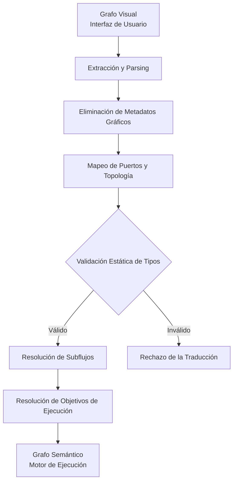
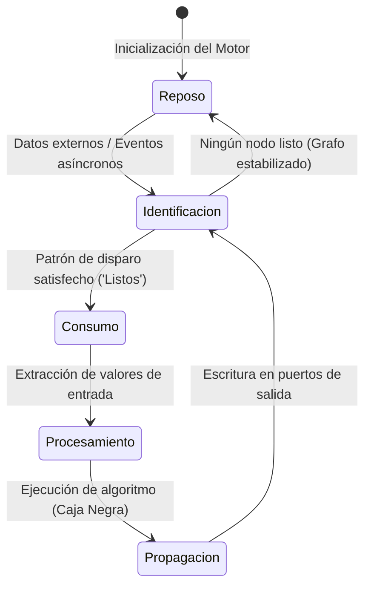

# Proceso de Compilación y Evaluación de Programas en NodeLand

## 1. Introducción

NodeLand opera sobre un paradigma de programación visual basado en flujos de datos (_dataflow_). En este entorno, los programas se construyen mediante la interconexión de bloques lógicos (nodos) a través de enlaces (aristas) que representan el tránsito de información. Para que esta representación gráfica, orientada primariamente a la interacción del usuario y la interfaz visual, pueda ser ejecutada de manera eficiente y predecible, el sistema implementa una arquitectura rigurosamente separada en dos fases principales: el proceso de **compilación** (o traducción semántica) y el proceso de **evaluación** (o ejecución en tiempo de ejecución).

El objetivo de este documento es detallar a nivel arquitectónico y conceptual cómo fluye la información desde el lienzo visual hasta el motor de procesamiento, destacando las decisiones de diseño adoptadas para garantizar robustez, extensibilidad y consistencia.

---

## 2. Fase de Compilación: Del Grafo Visual al Grafo Semántico

El lienzo donde el usuario diseña el programa contiene una vasta cantidad de metadatos irrelevantes para la lógica computacional (posiciones espaciales, dimensiones, estados de selección de la interfaz, colores). La primera responsabilidad del sistema es transformar este "Grafo Visual" en un "Grafo Semántico" o de ejecución puro.

### 2.1. Desacoplamiento y Parseo Estructural

El proceso de compilación inicia iterando sobre la colección completa de elementos visuales. Durante esta etapa:

- Se purgan los metadatos de la interfaz gráfica.
- Se instancian las representaciones lógicas puras correspondientes a cada tipo de nodo. Esto se logra mediante un patrón de diseño tipo "Fábrica" (Factory) y un conjunto de "Compiladores de Nodo", que saben exactamente cómo traducir las propiedades configuradas visualmente a parámetros estáticos de ejecución.

### 2.2. Mapeo de Puertos y Resolución de Topología

Los enlaces visuales (aristas) conectan puntos de anclaje de la interfaz. Sin embargo, el motor subyacente requiere conocer explícitamente qué salida lógica alimenta a qué entrada lógica.

- **Normalización de Conexiones:** El proceso de compilación resuelve el mapeo de los identificadores visuales de los puertos hacia identificadores semánticos estandarizados.
- **Validación de Tipos Estáticos:** Durante esta fase se efectúa una validación rigurosa basada en "máscaras" o compatibilidad de tipos de datos. El compilador verifica que el flujo de datos entre dos puertos sea semánticamente válido, previniendo errores de tipo en tiempo de ejecución derivados de conexiones gráficamente forzadas o corrompidas.

### 2.3. Resolución de Subflujos y Objetivos de Ejecución

En arquitecturas avanzadas donde se soportan abstracciones (como subflujos o macros) o ejecución distribuida (por ejemplo, delegar la ejecución a un microcontrolador externo):

- Los nodos que encapsulan subflujos se "desenrollan" o se enlazan referencialmente para ser evaluados como un contexto hijo.
- Se determina el "objetivo de ejecución" (_execution target_) de ciertos bloques de procesamiento para agrupar qué partes del grafo correrán en el motor principal y cuáles deben ser serializadas y transmitidas a un componente físico o servidor remoto.

---

## 3. Fase de Evaluación: El Ciclo de Vida del Motor

Una vez construido el grafo semántico, el Motor de Ejecución asume el control. NodeLand implementa un modelo de ejecución impulsado por disponibilidad de datos y patrones de disparo (_Fire Patterns_).

### 3.1. Estado y Ciclo de Evaluación

El motor preserva un estado global de ejecución (la "memoria" del programa) completamente aislado de la definición estática del grafo.
El ciclo de evaluación funciona iterativamente:

1. **Identificación de Nodos Listos:** El motor evalúa las políticas de disparo de cada nodo. Un nodo se considera "listo para ejecución" solo si sus entradas requeridas han recibido datos frescos de sus predecesores. Algunos nodos requieren que todas sus entradas estén satisfechas (operaciones aritméticas sincronizadas), mientras que otros pueden actuar independientemente con al menos una entrada (operaciones lógicas parciales o selectores).
2. **Consumo de Entradas:** Cuando un nodo se activa, extrae los valores de sus puertos de entrada.
3. **Procesamiento de la Lógica del Nodo:** Se invoca el algoritmo específico del nodo (matemática, lógica, control, etc.). Esta fase debe comportarse computacionalmente como una _caja negra_ determinista que transforma entradas en salidas.
4. **Propagación de Salidas:** Los resultados generados se escriben en los puertos de salida del nodo. El motor se encarga de transferir estos valores a través de las aristas del grafo hacia los nodos destino, marcando esas nuevas entradas como "modificadas" o "frescas".
5. **Reevaluación:** El ciclo se reinicia evaluando iterativamente la cascada de activaciones hasta que la red alcanza un estado de reposo (sin nuevos eventos o datos en tránsito).

### 3.2. Manejo de Flujo de Control e Iteraciones

A diferencia de los lenguajes imperativos clásicos, en un modelo _dataflow_ el control de flujo (como bucles o bifurcaciones condicionales) se maneja a nivel de puertas de paso (_gates_) y conmutadores (_switches_).

- **Nodos Especiales de Control:** Los nodos que actúan como "If/Else" enrutan el token de datos hacia un puerto u otro dependiendo de una señal booleana de evaluación.
- **Prevención de Ciclos Infinitos (Deadlocks / Livelocks):** En grafos que permiten bucles cerrados, el motor impone un control de flujo riguroso, a menudo implementado mediante un límite de iteraciones por ciclo global de evaluación (o manejo de frecuencia de actualización) para evitar el bloqueo del hilo de procesamiento.

### 3.3. Asincronía y Efectos Secundarios (I/O)

Los nodos que interactúan con el mundo exterior (eventos de hardware, respuestas de servidores remotos web sockets) actúan como "generadores". Introducen datos al ecosistema de forma asíncrona, actuando como la chispa inicial que despierta estados inactivos del grafo semántico y propaga una nueva cascada de evaluaciones.

---

## 4. Decisiones de Diseño y Consecuencias Arquitectónicas

1. **Separación Estricta de Interfaz y Motor (Desacoplamiento UI/Core):**
   _Justificación:_ Permitir que el motor de ejecución funcione en modo nulo (headless) en un entorno de servidor, terminal o Worker Thread sin depender de herramientas de manipulación del DOM (Document Object Model).
   _Consecuencia:_ Impone la necesidad del paso de "Compilación", añadiendo cierta complejidad en las estructuras de datos bidireccionales, pero dotando al sistema de escalabilidad e independencia.

2. **Tipado Estricto por Puertos en Compilación:**
   _Justificación:_ Los entornos de programación visual a menudo enfrentan problemas cuando se interconectan lógicas incompatibles.
   _Consecuencia:_ Implementar validación desde la compilación significa que si el Grafo llega al motor de ejecución, su tipología es computacionalmente segura. El motor no pierde ciclos valiosos determinando coherencia de tipos en tiempo real.

3. **Arquitectura Orientada a Patrones de Disparo (Fire Patterns):**
   _Justificación:_ Abstraer bajo qué condiciones un nodo lógico se activa permite una flexibilidad inmensa. Desde compuertas lógicas OR (que reaccionan al primer estímulo) hasta uniones analíticas complejas (que esperan la convergencia de ramas de distinta latencia).
   _Consecuencia:_ Permite al desarrollador del core agregar nuevos comportamientos lógicos extendiendo clases abstractas de nodos sin requerir modificar el complejo algoritmo del enrutador central de flujos.

## 5. Conclusión

El paradigma de arquitectura de NodeLand encapsula la complejidad inherente a un compilador tradicional y un integrador de grafos matemáticos a través de un enfoque determinista, modular y asíncrono. La decisión de separar tajantemente la vida efímera del control visual de la ejecución rigurosa y tipada del grafo semántico subyace como uno de los cimientos tecnológicos para proveer herramientas de validación preventiva e integración robótica en la misma plataforma.
